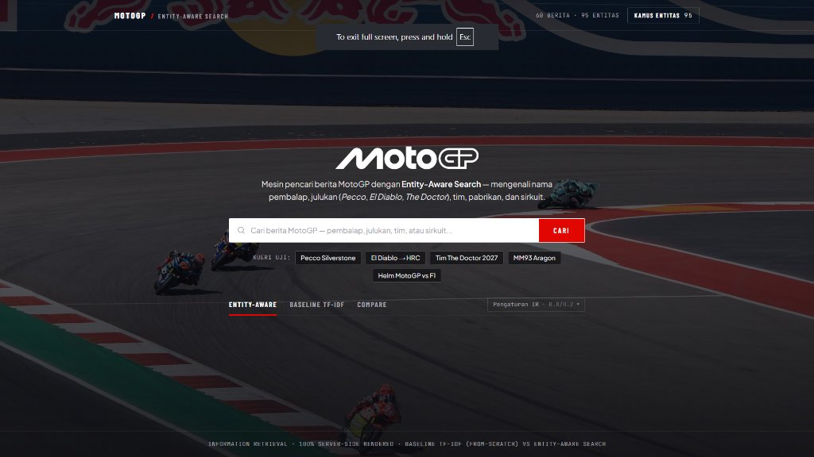

# MotoGP Entity-Aware Search Engine

An Information Retrieval (IR) web application for searching Indonesian MotoGP news articles, combining a **from-scratch TF-IDF + Cosine Similarity** baseline with a domain-specific **Entity-Aware Search** specialization.

> **Live Deployment (Vercel):**
>
> - **Web App (Frontend SSR):** https://motogp-entity-search-engine.vercel.app
> - **REST API (Backend):** https://motogp-entity-search-backend.vercel.app
> - **Interactive API Docs (Swagger):** https://motogp-entity-search-backend.vercel.app/docs



---

## Overview

Conventional keyword search struggles when users query MotoGP news using rider nicknames (_Pecco_, _El Diablo_, _La Bestia_, _The Doctor_), racing number codes (_MM93_, _FB63_), or team/circuit aliases that differ from the exact words printed in an article.

This project implements and evaluates two independently executable retrieval pipelines:

1. **Baseline Retrieval (`baseline`)** — From-scratch Inverted Index, TF-IDF ($\text{IDF}(t) = \log_{10}(N / \text{df}(t))$), and Cosine Similarity ($S_{\text{text}}$).
2. **Entity-Aware Retrieval (`entity`)** — Dictionary-based entity & alias recognition (_Longest-Match-First_ + word-boundary span masking), Query Entity Coverage scoring ($S_{\text{entity}}$) over an entity index in Neon PostgreSQL, linear score fusion ($S_{\text{final}} = \alpha S_{\text{text}} + \beta S_{\text{entity}}$), and automatic **Fallback Behavior** for non-entity queries.

---

## Key Features

### Information Retrieval Engine (100% From-Scratch)

- **Consistent Indonesian Preprocessing:** NFKD accent folding (`Márquez → marquez`), URL/newsroom noise cleanup, alphanumeric tokenization (`[a-z0-9]+`), pure-digit filtering (retaining domain tokens such as `fp1`, `moto2`, `vr46`), Sastrawi + domain stopword removal preserving negation (`tidak`, `bukan`, `jangan`, `tanpa`, `belum`), MotoGP term normalization, and cached Sastrawi stemming.
- **From-Scratch Vector Space Model:** Custom Inverted Index, $\text{IDF}(t) = \log_{10}(N / \text{df}(t))$, dot product, vector length, and Cosine Similarity with zero external ML/IR library dependency (`scikit-learn` is not used in the production engine).
- **3-Source Verified Entity Dictionary:** **95 canonical entities** and **390 aliases** curated from the 60-article corpus, official `motogp.com` grid/calendar records, and external motorsport sources (Wikipedia/Crash.net/Motorsport).
- **Automatic Fallback Behavior:** When no MotoGP entity is detected in a query ($E_Q = \emptyset$), the engine falls back strictly to Baseline TF-IDF without injecting artificial entity scores.

### Web Application (Server-Side Rendered)

- **Next.js App Router SSR:** Search, Compare, Article Detail (`/articles/[docId]`), and Entity Dictionary (`/entities`, `/entities/[entityId]`) are rendered server-side via React Server Components with server-to-server calls to FastAPI.
- **Side-by-Side Compare Mode:** Compares Baseline TF-IDF and Entity-Aware rankings side by side with live rank-delta indicators (`▲ +N`, `▼ -N`, `NEW`) and configurable $(\alpha, \beta)$ weight presets.
- **Telemetry & Transparency:** Displays recognized query entities (with alias provenance), fallback status, per-article score breakdown (`S_final`, `S_text`, `S_entity`), and full original news content with entity mention counts.

---

## Technology Stack

| Component               | Technology                                               |
| :---------------------- | :------------------------------------------------------- |
| **Frontend**            | Next.js 14 (App Router, SSR), TypeScript, Tailwind CSS   |
| **Backend**             | Python, FastAPI, Uvicorn, Pydantic v2                    |
| **Database**            | Neon PostgreSQL (Serverless)                             |
| **Database Driver**     | `psycopg` v3 (`psycopg[binary,pool]`)                    |
| **IR Engine**           | Pure Python From-Scratch TF-IDF & Entity Coverage (`v5`) |
| **Indonesian NLP**      | PySastrawi (cached stemming + stopwords)                 |
| **Index Serialization** | Joblib (`backend/artifacts/index.joblib`)                |
| **Hosting**             | Vercel (Frontend + Zero-Config FastAPI Backend)          |

---

## Dataset & Entity Dictionary

### News Corpus (`documents`)

Curated corpus of **60 MotoGP news articles** from three Indonesian publishers:

| Publisher | Articles |
| :-------- | -------: |
| Kompas    |       20 |
| ANTARA    |       20 |
| IDN Times |       20 |
| **Total** |   **60** |

- **Indexed Unique Vocabulary:** `1,890` stemmed terms (`documents.processed_text`)
- Original article text is preserved intact in `documents.content`.

### Entity Dictionary (`entities`, `entity_aliases`, `document_entities`)

| Category     |                                        Canonical Entities |
| :----------- | --------------------------------------------------------: |
| Rider        |                                                        50 |
| Team         |                                                        15 |
| Manufacturer |                                                        10 |
| Circuit      |                                                        20 |
| **Total**    | **95 entities · 390 aliases · 597 document-entity links** |

- **3-Source Alias Provenance:** `116` corpus-derived aliases, `192` official `motogp.com` forms & racing number codes (`MM93`, `FB63`, etc.), and `82` external nicknames/prototype bike codes/GP-to-circuit aliases.

---

## System Architecture

```text
                       User Request (Browser)
                                 |
                      Next.js Server (SSR / RSC)
                                 |  Server-to-Server (BACKEND_API_URL)
                      FastAPI Backend (Vercel)
                                 |
                 +---------------+---------------+
                 |                               |
          Text Retrieval                 Entity Retrieval
     (From-Scratch TF-IDF +         (Longest-Match Dictionary +
        Cosine Similarity)            Neon document_entities)
                 |                               |
                 +---------------+---------------+
                                 |
                    Hybrid Score Fusion (v5)
              S_final = alpha * S_text + beta * S_entity
                                 |
                          Ranked Results
```

### Scoring Formulas

- **Entity Relevance (Query Entity Coverage):**
  $$S_{\text{entity}}(D, Q) = \frac{|E_Q \cap E_D|}{|E_Q|}$$
- **Hybrid Final Score (default $\alpha = 0.8,\ \beta = 0.2$):**
  $$S_{\text{final}}(D, Q) = \alpha \cdot S_{\text{text}}(D, Q) + \beta \cdot S_{\text{entity}}(D, Q)$$
- **Fallback Rule:** If $E_Q = \emptyset$, then $S_{\text{entity}} = 0$ and $S_{\text{final}} = S_{\text{text}}$.

---

## Evaluation Results

Evaluated on **12 manually relevance-judged queries (`Q01`–`Q12`)** covering alias/nickname queries, canonical multi-entity queries, and non-entity fallback queries. The production FastAPI engine achieves **12/12 exact parity** with the experimental `v5` evaluation notebook.

### 1. Entity Recognition Validation (12 Gold Standard Articles)

- **True Positives:** `118` | **False Positives:** `0` | **False Negatives:** `0`
- **Micro-Precision:** `1.0000` | **Micro-Recall:** `1.0000` | **Micro-F1:** `1.0000`

### 2. Document Retrieval Comparison ($\alpha = 0.8,\ \beta = 0.2$)

| Query Group                                  | System                      | Precision@5  |       Recall@10        |          MAP           |
| :------------------------------------------- | :-------------------------- | :----------: | :--------------------: | :--------------------: |
| **All Queries (`Q01`–`Q12`)**                | Baseline (TF-IDF)           |   `0.5833`   |        `0.8417`        |        `0.8046`        |
|                                              | **Proposed (Entity-Aware)** | **`0.6167`** | **`0.9236` (+8.19%)**  | **`0.8586` (+5.40%)**  |
| **Entity-Based (`Q01`–`Q09`)**               | Baseline (TF-IDF)           |   `0.6889`   |        `0.7889`        |        `0.7858`        |
|                                              | **Proposed (Entity-Aware)** | **`0.7333`** | **`0.8981` (+10.92%)** | **`0.8578` (+7.20%)**  |
| **Subgroup: Alias / Nickname (`Q01`–`Q04`)** | Baseline (TF-IDF)           |   `0.5500`   |        `0.7208`        |        `0.6841`        |
|                                              | **Proposed (Entity-Aware)** | **`0.6000`** | **`0.8750` (+15.42%)** | **`0.8161` (+13.20%)** |
| **Subgroup: Canonical Entity (`Q05`–`Q09`)** | Baseline (TF-IDF)           |   `0.8000`   |        `0.8433`        |        `0.8672`        |
|                                              | **Proposed (Entity-Aware)** | **`0.8400`** | **`0.9167` (+7.34%)**  | **`0.8912` (+2.40%)**  |
| **Non-Entity / Fallback (`Q10`–`Q12`)**      | Baseline & Proposed         |   `0.2667`   |        `1.0000`        | `0.8611` _(Identical)_ |

Full experiment CSV exports are stored in [`doc/Experiment-Result/v5_result/`](doc/Experiment-Result/v5_result/).

---

## REST API Endpoints

| Method | Endpoint                       | Description                                                               |
| :----- | :----------------------------- | :------------------------------------------------------------------------ |
| `GET`  | `/`                            | Service metadata & links to docs/health                                   |
| `GET`  | `/api/v1/health`               | API health, Neon PostgreSQL status, and index readiness                   |
| `GET`  | `/api/v1/index/status`         | Active index summary (`engine`, document/term/entity counts)              |
| `GET`  | `/api/v1/search`               | Search documents (`q`, `mode=entity\|baseline`, `top_k`, `alpha`, `beta`) |
| `GET`  | `/api/v1/search/compare`       | Side-by-side Baseline vs Entity-Aware search results                      |
| `GET`  | `/api/v1/documents`            | Paginated document list with optional `media` filter                      |
| `GET`  | `/api/v1/documents/{doc_id}`   | Full original article content and indexed entities                        |
| `GET`  | `/api/v1/entities`             | List all verified entities with aliases (`category` filter supported)     |
| `GET`  | `/api/v1/entities/{entity_id}` | Entity profile, aliases, official reference, and related articles         |
| `GET`  | `/api/v1/entities/recognize`   | Debug entity recognition on arbitrary text (`text`)                       |
| `POST` | `/api/v1/admin/index/rebuild`  | Rebuild & hot-reload index from Neon PostgreSQL                           |
| `GET`  | `/api/v1/evaluation/run`       | Run live `Precision@K`, `Recall@K`, and `MAP` evaluation                  |

---

## Repository Structure

```text
motogp-entity-search-engine/
├── backend/
│   ├── app/
│   │   ├── api/            # FastAPI routers (search, documents, entities, health, index, evaluation)
│   │   ├── core/           # Settings (config.py) and psycopg connection pool (db.py)
│   │   ├── services/       # From-scratch TF-IDF indexer, search, entity recognizer, preprocessing, DB repo
│   │   ├── main.py         # FastAPI entrypoint (Vercel zero-config)
│   │   └── schemas.py      # Pydantic response models
│   ├── artifacts/
│   │   └── index.joblib    # Prebuilt v5 from-scratch index artifact
│   ├── scripts/            # build_index.py
│   ├── requirements.txt
│   └── .env.example
├── frontend/
│   ├── app/
│   │   ├── articles/[docId]/   # SSR Article Detail page + loading skeleton
│   │   ├── entities/           # SSR Entity Directory & [entityId] Detail pages
│   │   ├── icon.svg            # Motorsport Editorial browser tab favicon
│   │   ├── layout.tsx          # Google Fonts (Barlow Condensed, Titillium Web, Plus Jakarta Sans, JetBrains Mono)
│   │   └── page.tsx            # SSR Search & Compare workspace with Suspense streaming
│   ├── components/             # Motorsport Editorial UI components
│   ├── lib/                    # Server API client, types, formatters
│   ├── public/                 # MotoGP hero background & logo
│   └── .env.local.example
├── doc/
│   ├── corpus(combined)/       # Original Excel corpus
│   ├── Experiment-Result/      # v2, v3, v4, and v5 evaluation CSV outputs
│   └── screenshots/            # README preview screenshots
└── README.md
```

---

## Getting Started (Local Development)

### Prerequisites

- **Python 3.11+**
- **Node.js 18+**
- **Neon PostgreSQL** connection string (optional for offline artifact testing, required for live DB queries)

### 1. Backend Setup (`http://localhost:8000`)

```powershell
cd backend
python -m venv .venv
.\.venv\Scripts\pip.exe install -r requirements.txt
copy .env.example .env
```

Edit `backend/.env` and set your Neon PostgreSQL connection string (`DATABASE_URL=...`), then run:

```powershell
# Optional: rebuild index directly from Neon PostgreSQL
.\.venv\Scripts\python.exe -m scripts.build_index

# Start FastAPI server
.\.venv\Scripts\python.exe -m uvicorn app.main:app --reload --port 8000
```

### 2. Frontend Setup (`http://localhost:3000`)

```powershell
cd frontend
npm ci
copy .env.local.example .env.local
npm run dev
```

Open **http://localhost:3000** in your browser.

---

## Deployment (Vercel)

Both services are deployed as independent Vercel projects from this monorepo:

1. **Backend Project (`Root Directory: backend`, Framework Preset: `FastAPI`):**
   - Environment variables: `DATABASE_URL` (Neon `-pooler` URL), `DEFAULT_ALPHA=0.8`, `DEFAULT_BETA=0.2`, `USE_STORED_PROCESSED_TEXT=true`, `USE_STORED_DOCUMENT_ENTITIES=true`, `CORS_ORIGINS=http://localhost:3000,https://<frontend-domain>`.
2. **Frontend Project (`Root Directory: frontend`, Framework Preset: `Next.js`):**
   - Environment variable: `BACKEND_API_URL=https://<backend-domain>`.
